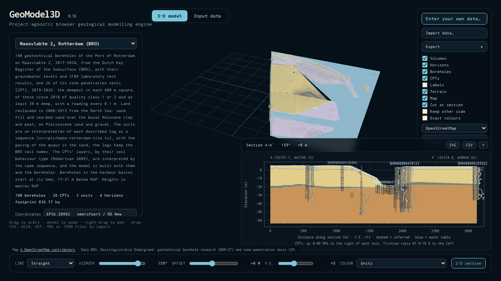
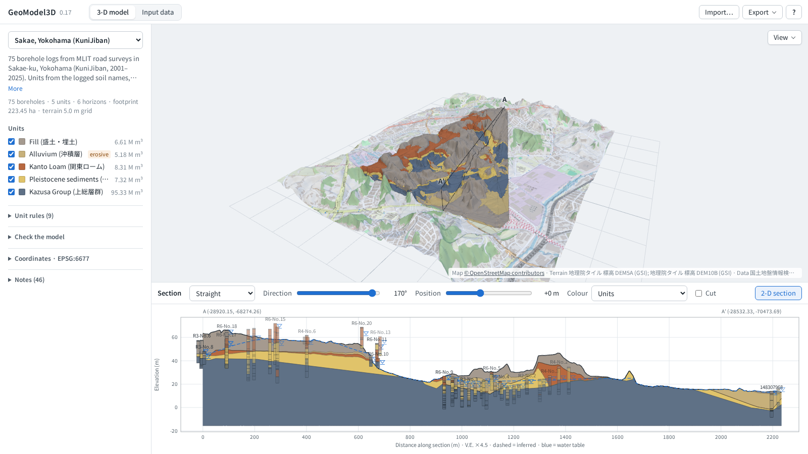

# GeoModel3D

3-D geological models from borehole logs and CPTs, in the browser.

[](https://kilickursat.github.io/GeoModel3D/)
[](https://github.com/kilickursat/GeoModel3D/actions/workflows/build.yml)
[](LICENSE)

GeoModel3D builds a layered ground model from borehole logs and cone penetration tests and puts it on a map in the site's own coordinate system. You can cut sections through it at any angle or along a tunnel or road alignment. It runs in the browser on a computer, tablet or phone. There is nothing to install, and your data are not uploaded anywhere.



**Open it:** [kilickursat.github.io/GeoModel3D](https://kilickursat.github.io/GeoModel3D/). Where hosted pages or local servers are not allowed, download [geomodel3d-offline.html](https://kilickursat.github.io/GeoModel3D/geomodel3d-offline.html): one file that opens from disk.

## What it does

- Builds the model from boreholes, CPTs or both: horizons between the boreholes and a closed volume for each unit. One borehole is enough to start.
- Cuts sections at any direction and position, or along an alignment from LandXML, CSV, GeoJSON or DXF, or drawn on the model. Along a line it gives a table by chainage with the cover and the units at the crown and invert.
- Shows groundwater, σv, u, σ′v and σ′h on sections, and interpolates laboratory and in-situ results within each unit.
- Classifies CPTs by Robertson's soil behaviour type (2009). Their layers can build the model alongside the boreholes.
- Gives active, at-rest and passive earth pressures (Rankine) down a borehole of your own case.
- Checks the model by leaving each borehole out and predicting it from the others, so you can see how far to trust it between boreholes.
- Exports a PDF report, sections as SVG or CSV, the project as JSON, and the model as GLB or USDZ for augmented reality.



## Your data

Use **Import…** or drop the files on the page:

| Data | Formats |
|---|---|
| Boreholes | CSV tables ([templates](docs/templates)), AGS4, Japanese electronic-delivery XML (KuniJiban), Dutch BRO and Flemish DOV XML, project JSON |
| CPTs | GEF, BRO and DOV CPT XML, AGS4 (`SCPG`, `SCPT`), CSV |
| Terrain | ESRI ASCII grid (`.asc`), gridded `x y z` |
| Alignments | LandXML and J-LandXML, CSV, GeoJSON, DXF |

Or type your case into the **Input data** tab, or paste it from a spreadsheet. [Data formats](docs/data-formats.md) lists the columns and fields each format may have.

## Sample sites

The app opens with four real sites, each in its country's coordinate system and height datum, and three synthetic ones.

| Site | Data | Source and terms |
|---|---|---|
| Sakae, Yokohama, Japan | 75 borehole logs from road surveys | KuniJiban (MLIT, PWRI, PARI); free to reuse with the source shown |
| Antwerp, Belgium | 170 boreholes with formal stratigraphy | DOV, Flemish Government; model licence for free reuse |
| Maasvlakte 2, Rotterdam, Netherlands | 100 boreholes, 26 CPTs, 3,188 laboratory results | BRO; public domain (CC0) |
| Creswick, Victoria, Australia | 150 groundwater bores over buried river gravels | NGIS, Bureau of Meteorology; CC BY 3.0 AU |

How each site was prepared, and the full credits, are in [sites](docs/sites.md).

## How the model is built

The logs give the elevation of each contact at each borehole. The horizons are triangulated between the boreholes, kept in stratigraphic order, and closed into unit volumes. A unit missing from a log pinches out at that borehole. Erosive units cut the units below them. With a terrain grid, the ground follows the terrain and the collars keep their surveyed levels. [Methods](docs/methods.md) has the details, and [the guide](docs/guide.md) covers every part of the app.

## Run it yourself

```sh
npm ci
npm test        # unit tests
npm run build   # dist/ and dist/geomodel3d-offline.html
```

The build is static: `dist/` can be served from any web host, and the offline file needs none.

## Contributing

Bug reports, ideas, code and openly licensed data are welcome. See [CONTRIBUTING.md](CONTRIBUTING.md), and please open an [issue](https://github.com/kilickursat/GeoModel3D/issues) before starting a larger change. [CHANGELOG.md](CHANGELOG.md) lists what changed in each version.

You can support the project on [Patreon](https://www.patreon.com/geotechCLI). To sponsor its development, contact Kursat Kilic at [kilic_kursat@hotmail.com](mailto:kilic_kursat@hotmail.com).

## Citing

GitHub's **Cite this repository** gives the reference from [CITATION.cff](CITATION.cff):

```bibtex
@software{kilic_geomodel3d,
  author  = {Kilic, Kursat},
  title   = {GeoModel3D: 3D geological models from borehole logs and CPTs, in the browser},
  url     = {https://github.com/kilickursat/GeoModel3D},
  version = {0.17.0},
  year    = {2026},
  license = {Apache-2.0}
}
```

## License

Apache-2.0: see [LICENSE](LICENSE). The data of the sample sites keep their own terms, listed in [sites](docs/sites.md#data-sources).
