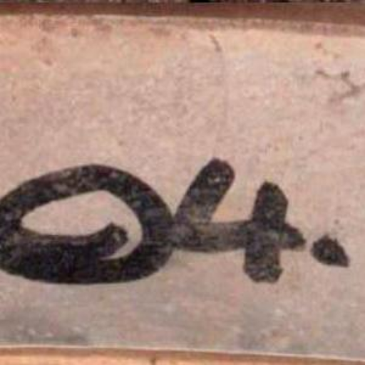
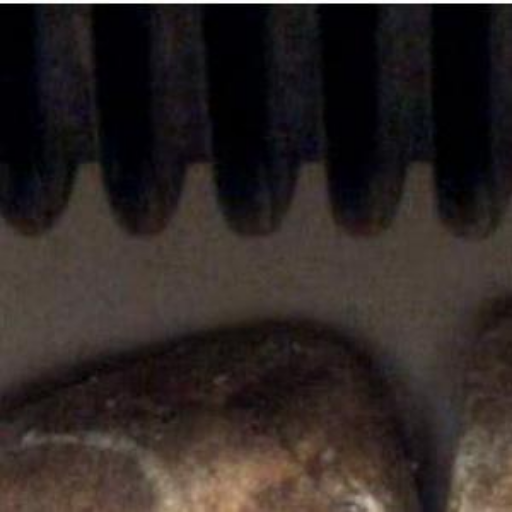
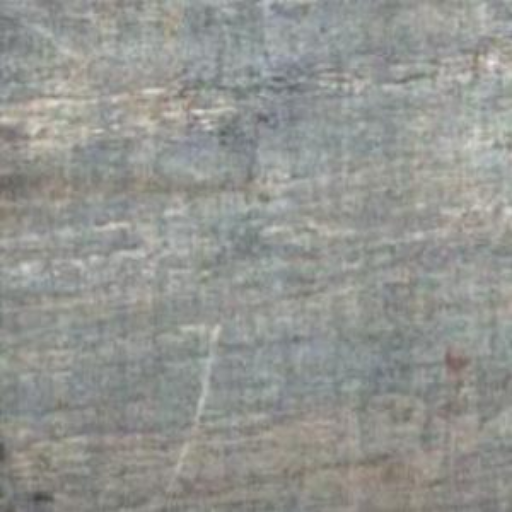
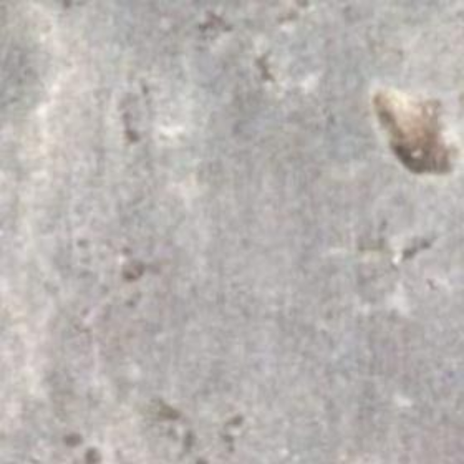
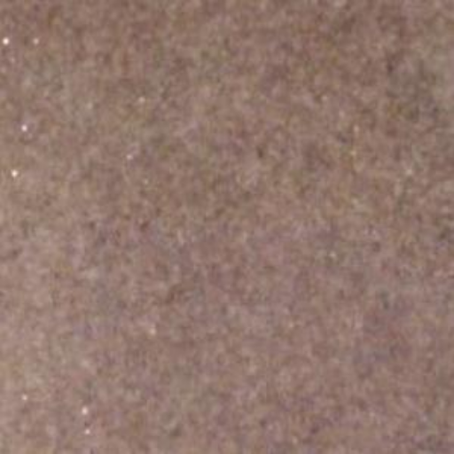
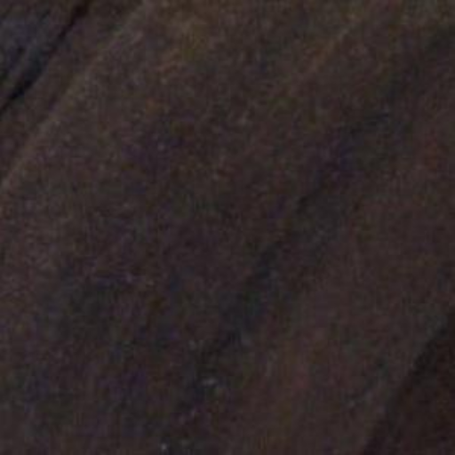
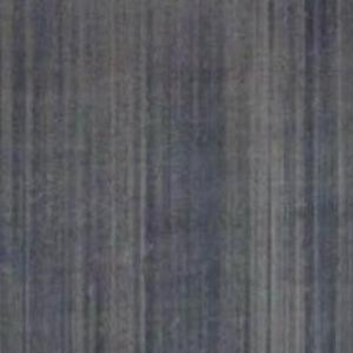
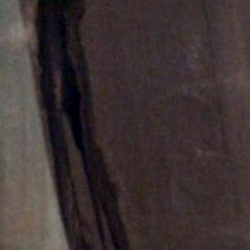

# All paired outputs

Eight fixed cases; one generation per model/case. Images are CC BY-SA 4.0 with [source attribution and changes](NOTICE.md). Source class labels are published dataset context, not model predictions. [Method and limitations](README.md) · [Frozen assistant review with every claim and reason](blinded-review.json).

Scores are rubric points out of eight, not accuracy percentages. The frozen rubric awards one point for an omitted category: even a nonresponsive answer can score four points while failing usefulness. Minimum usefulness allows noncritical unverified claims, which remain recorded in the detailed review.

## sample-01

Published source class: **garbage**.

### SmolVLM 500M

Rubric: **4/8 points**. Minimum usefulness: **not met**. Critical flags: **0**. Token cap reached: **no**.

> O.

Review: No specific supported image observation.

### Qwen3.5 0.8B

Rubric: **7/8 points**. Minimum usefulness: **met**. Critical flags: **0**. Token cap reached: **no**.

> - The text appears as a dark, hand-drawn number "04." in ink on a light-colored surface.
> - The font style is informal and uneven, with varying stroke widths and irregular letterforms.
> - There are faint, smudged marks and minor imperfections around the characters, suggesting manual creation rather than precise printing.
> - No clear background context (like stone, concrete, or paper) can be definitively identified due to low resolution and limited visibility.

Review: At least one specific supported visual observation, no substantive visual contradiction, and no critical failure; separately listed noncritical unverified claims are not excused.

## sample-02

Published source class: **garbage**.

### SmolVLM 500M

Rubric: **4/8 points**. Minimum usefulness: **not met**. Critical flags: **0**. Token cap reached: **no**.

> Yes.

Review: No specific supported image observation.

### Qwen3.5 0.8B

Rubric: **6/8 points**. Minimum usefulness: **met**. Critical flags: **0**. Token cap reached: **no**.

> - **Color**: The dominant color appears as a muted grayish-brown with some lighter areas near the top edge.
> - **Texture**: The surface looks rough and uneven, resembling metal or stone, with darker lines separating sections.
> - **Visible Edges/Gaps**: There are distinct vertical ridges or teeth along the upper portion that create a segmented appearance.

Review: At least one specific supported visual observation, no substantive visual contradiction, and no critical failure; separately listed noncritical unverified claims are not excused.

## sample-03

Published source class: **limestone**.

### SmolVLM 500M

Rubric: **4/8 points**. Minimum usefulness: **not met**. Critical flags: **0**. Token cap reached: **no**.

> Yes.

Review: No specific supported image observation.

### Qwen3.5 0.8B

Rubric: **5/8 points**. Minimum usefulness: **met**. Critical flags: **0**. Token cap reached: **no**.

> - **Colour**: The dominant hue is a pale, muted grey with subtle variations in tone ranging from light silver-grey to slightly darker greys. There are fainter areas of off-white or very light gray that blend into the background.
> - **Texture**: The surface exhibits a rough, mottled appearance typical of stone or concrete. It displays fine lines, scratches, and uneven surface imperfections rather than smooth planes.
> - **Visible Edges/Gaps**: The image appears to be a continuous close-up of a single object; there are no distinct gaps between individual pieces or clear outlines separating different parts of the material.

Review: At least one specific supported visual observation, no substantive visual contradiction, and no critical failure; separately listed noncritical unverified claims are not excused.

## sample-04

Published source class: **limestone**.

### SmolVLM 500M

Rubric: **4/8 points**. Minimum usefulness: **not met**. Critical flags: **0**. Token cap reached: **no**.

> Yes.

Review: No specific supported image observation.

### Qwen3.5 0.8B

Rubric: **2/8 points**. Minimum usefulness: **not met**. Critical flags: **0**. Token cap reached: **no**.

> The image displays a pale, featureless surface with no discernible geological structure, mineral composition, or physical characteristics such as fractures or hardness. The texture appears uniform and lacks any distinct patterns, suggesting an abstract representation rather than a natural object like rock.

Review: Has a substantive contradiction with the image, despite some correct content.

## sample-05

Published source class: **sandstone**.

### SmolVLM 500M

Rubric: **2/8 points**. Minimum usefulness: **not met**. Critical flags: **0**. Token cap reached: **yes**.

> **Image Description**
>
> The image displays a close-up view of the ground surface with an uneven texture. The ground appears to be made of a light brown material, possibly mulch or grass. There are no discernible patterns or textures on the ground, making it seem like a natural, unaltered surface.
>
> The ground's color is predominantly light brown, which could indicate that it might be made of mulch or grass. The ground seems to have some small gaps or irregularities in its texture, but they are not very prominent.
>
> The ground is not covered by any other objects or structures. It is the main focus

Review: Has a substantive contradiction with the image, despite some correct content.

### Qwen3.5 0.8B

Rubric: **3/8 points**. Minimum usefulness: **not met**. Critical flags: **0**. Token cap reached: **no**.

> - The surface displays a uniform, light greyish-grey tone with no distinct color variations.
> - The texture appears consistent across the entire frame, featuring a fine, mottled pattern without any obvious irregularities.
> - There are no discernible edges, borders, or gaps in the visual field; the image presents as a continuous, featureless area.

Review: Has a substantive contradiction with the image, despite some correct content.

## sample-06

Published source class: **sandstone**.

### SmolVLM 500M

Rubric: **2/8 points**. Minimum usefulness: **not met**. Critical flags: **1**. Token cap reached: **yes**.

> **Image Description**
>
> The image displays a close-up view of the surface of a rock with a rough texture. The rock appears to be unevenly shaped, with visible cracks and crevices. The surface shows a mix of colors, primarily browns and blacks, which are indicative of the natural mineral composition. There are some small white specks scattered across the surface, possibly representing mineral deposits or other impurities.
>
> The edges of the rock are somewhat blurred, suggesting that the focus remains on the main body of the rock. The edges also hint at the presence of cracks, which might indicate the nature of the rock's structure.

Review: Has a critical unsupported mineral inference.

### Qwen3.5 0.8B

Rubric: **5/8 points**. Minimum usefulness: **met**. Critical flags: **0**. Token cap reached: **no**.

> - **Colour**: The dominant hue appears as a muted grayish-brown with subtle variations in tone across the surface.
> - **Texture**: The material displays a coarse, granular appearance with fine, irregular lines running diagonally through the frame.
> - **Visible Edges/Gaps**: There are faint diagonal striations suggesting a layered structure, though no distinct solid boundaries or clear gaps can be definitively identified due to the low resolution.

Review: At least one specific supported visual observation, no substantive visual contradiction, and no critical failure; separately listed noncritical unverified claims are not excused.

## sample-07

Published source class: **shale**.

### SmolVLM 500M

Rubric: **4/8 points**. Minimum usefulness: **not met**. Critical flags: **0**. Token cap reached: **no**.

> Yes.

Review: No specific supported image observation.

### Qwen3.5 0.8B

Rubric: **5/8 points**. Minimum usefulness: **met**. Critical flags: **0**. Token cap reached: **no**.

> - **Colour**: The surface displays a muted grey tone with subtle variations in shade, creating a soft gradient from lighter areas on the left to darker regions on the right.
> - **Texture**: The material exhibits a fine, vertical striation pattern that resembles wood grain but appears more uniform than typical stone textures.
> - **Visible Edges/Gaps**: There are no distinct borders separating different sections; instead, the entire frame shows continuous, overlapping lines indicating a seamless finish.

Review: At least one specific supported visual observation, no substantive visual contradiction, and no critical failure; separately listed noncritical unverified claims are not excused.

## sample-08

Published source class: **shale**.

### SmolVLM 500M

Rubric: **4/8 points**. Minimum usefulness: **not met**. Critical flags: **0**. Token cap reached: **no**.

> Yes.

Review: No specific supported image observation.

### Qwen3.5 0.8B

Rubric: **7/8 points**. Minimum usefulness: **met**. Critical flags: **0**. Token cap reached: **no**.

> - **Color**: The dominant color is a muted grayish-brown with darker streaks running vertically through the center. There are lighter areas on the left side that appear slightly whiter or off-white compared to the surrounding brown tones.
> - **Texture**: The surface displays a mottled pattern where the colors blend into one another in irregular ways, creating a rough, uneven appearance rather than a smooth finish.
> - **Visible Edges/Gaps**: On the far left edge, there appears to be a distinct gap or separation from the main body of the object, which contrasts sharply with the continuous lines seen further right.

Review: At least one specific supported visual observation, no substantive visual contradiction, and no critical failure; separately listed noncritical unverified claims are not excused.
