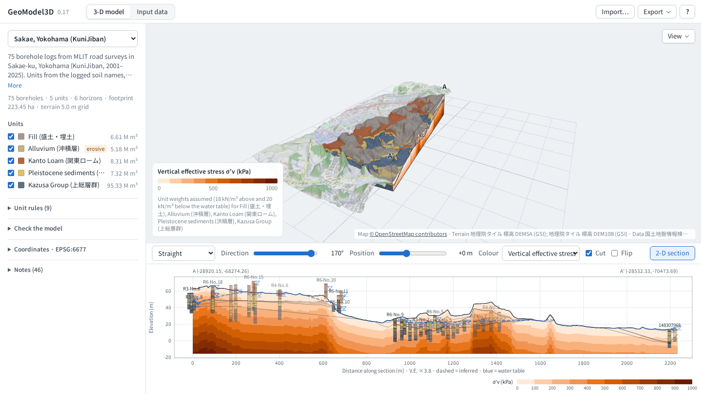
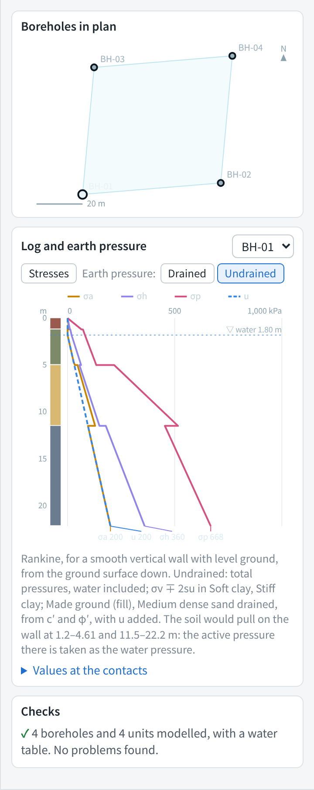
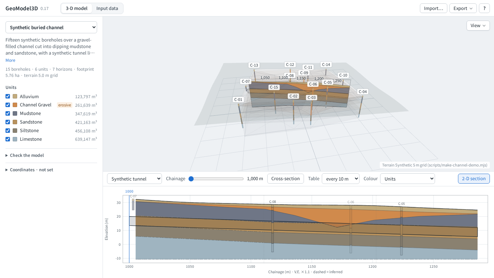
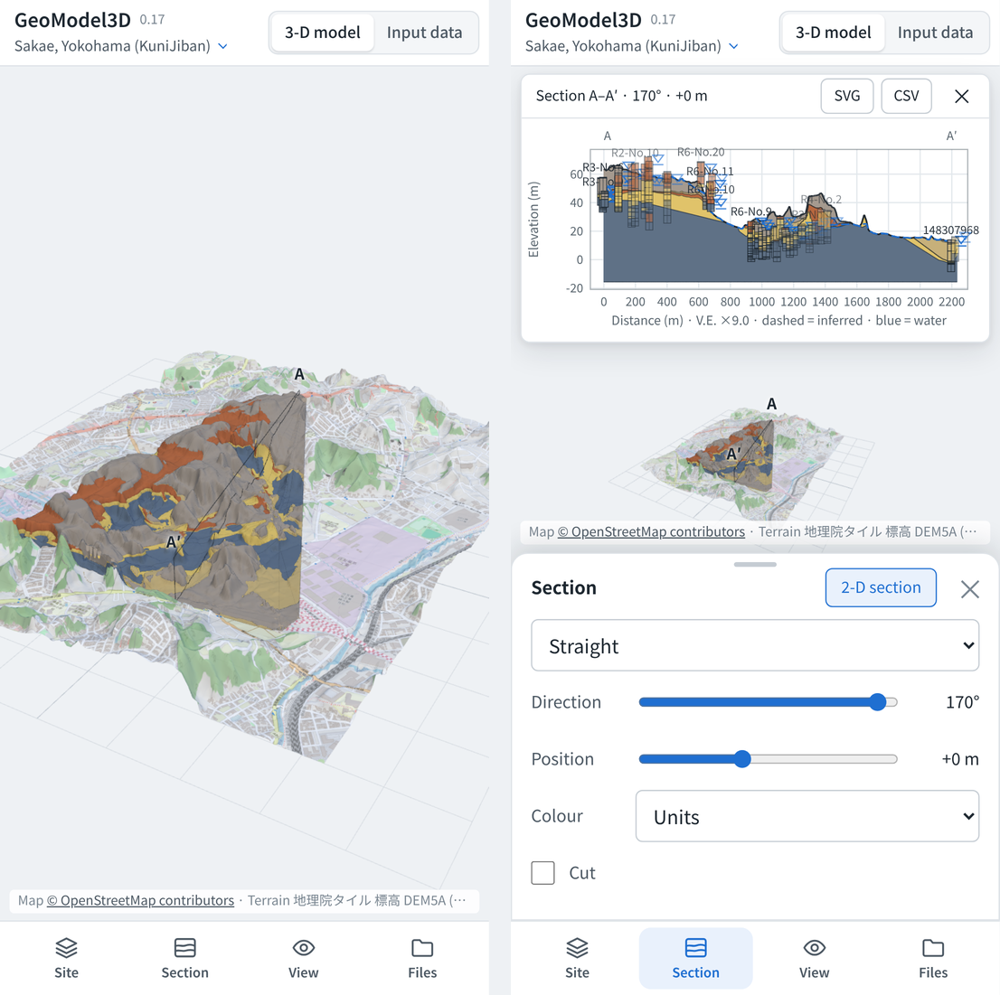

# Using GeoModel3D

The parts of the app beyond turning a model and cutting sections: your own data, stresses and properties, earth pressures, sections along a line, CPTs, the check of the model, AR and phones. How the model itself is built is in [methods](methods.md); file formats are in [data formats](data-formats.md).

## Entering your own data

The **Input data** tab, next to **3-D model** at the top of the page, is where you enter your own case and model it. Open it there, with **Enter your own data…** in the site list, or directly at [kilickursat.github.io/GeoModel3D/#input](https://kilickursat.github.io/GeoModel3D/#input).

**Start** offers:
- **New case:** empty tables to fill in;
- **Worked example:** four boreholes with water levels, SPT, laboratory tests and unit parameters, to see the format and change it;
- **Edit the site shown:** the tables of the model on screen, to change or add to;
- **Import files…:** CSV, AGS4, borehole XML or project JSON, opened here for review before building;
- **Continue the saved case:** what you typed before, if this browser kept it.

Then fill in the steps:

| Step | Holds |
|---|---|
| Project | Name, description, data source, coordinate system (EPSG code, name or PROJ definition; empty or any other name for a local grid), assumed groundwater depth, model base, model extent beyond the boreholes |
| Boreholes | Borehole, easting and northing *or* latitude and longitude, ground level, final depth |
| Logs | Borehole, from, to, unit, description. **Fill units from descriptions** applies the project's unit rules, or the grouping by principal soil |
| Water levels | Borehole, depth to water, date |
| SPT | Borehole, depth, blows, penetration |
| Tests | Borehole, depth, to, property, value: any laboratory or in-situ result |
| Units | Unit, name, colour, erosive, γ, γsat, c′, φ′, su, E, k, K0, source, in stratigraphic order (▲ ▼ to reorder) |

While you type, the preview shows:
- **the boreholes in plan**, with the outline of the model; click a borehole to show it;
- **the log of one borehole** as the model has it, with the vertical total stress σv, the pore pressure u, the vertical effective stress σ′v and, where K0 is given, the horizontal effective stress σ′h down it. Hover for the values at any depth; **Values at the contacts** lists them at the top and base of each unit. **Earth pressure: Drained** or **Undrained** shows instead the active, at-rest and passive earth pressures on a wall down it (see [Earth pressures](#earth-pressures));
- **the checks** of the importer and the model: rows that cannot be used, values outside plausible ranges, units out of order.

**Build model** turns the tables into the model through the same importer as CSV files, and shows it in 3-D, where sections can be coloured by stresses or measured properties and a PDF report can be printed.

Good to know:
- **One borehole is enough.** A single borehole needs neither a position nor a ground level (0, 0 and 0 m are used, and said so). One or two boreholes, or boreholes in a line, are modelled over an extent around them; set **Model extent beyond the boreholes** to choose it, or to extend any model beyond its outermost boreholes.
- **Unit weights** give the stresses: γ above the water table and γsat below it. A unit without them takes the mean measured unit weight, or else 18 and 20 kN/m³, which the preview and the report say. **K0** gives σ′h, and **c′, φ′ and su** the earth pressures. E and k are design parameters, kept with the model and listed in the report.
- **Pasting:** cells copied from a spreadsheet paste into any table, starting at the cell pasted into, and add rows as needed. Large tables are shown one borehole at a time.
- **Nothing is uploaded.** What you type is kept in this browser, so a reload does not lose it, until you type in another case. **Save case (JSON)** keeps a copy you can import again, and **Download table (CSV)** saves a table as CSV.

## Groundwater, stresses and measured properties

**Colour**, on the section bar, colours the 2-D section, and the section face in 3-D where the model is cut or see-through, by one of:
- **Units** (the default);
- **vertical total stress σv**, **pore water pressure u**, **vertical effective stress σ′v**, or, where the units are given a K0, **horizontal effective stress σ′h**;
- **any measured property**.

Colours are bands of one hue, with a legend that states what the field rests on.

How the fields are computed:
- **Water table:** it runs through the shallowest water level logged in each borehole, interpolated between boreholes and kept at or below the ground. Where no borehole has a water level, the project's assumed groundwater depth is used. It is drawn blue on sections, with ▽ at the logged levels.
- **Stresses:**
  - σv sums unit weight × thickness from the ground down, using γ above the water table and γsat below it.
  - u is hydrostatic below the water table, and σ′v = σv − u.
  - σ′h = K0 · σ′v with each unit's own K0; units without a K0 are left uncoloured, and the legend names them.
  - Unit weights are, in order of preference: the unit's own values; the mean measured bulk unit weight in the unit; or an assumed 18 and 20 kN/m³. Assumed values are reported, because they suit few soils: peat or volcanic ash are much lighter, rock heavier.
  - Where the water table is at the ground, as under open water, stresses are counted from the ground.
- **Measured properties** (SPT N, water content, su…, and the CPT readings qc, fs, Rf and u2):
  - they are interpolated within each unit only, by inverse distance with horizontal distances shortened ten times, since properties vary much more with depth than across a site;
  - CPT readings enter as their means over 0.5 m, in the unit of the model at their elevation;
  - units where a property was not measured stay grey;
  - SPT N-values are coloured up to 50, the usual refusal.
- **Read-outs:** hovering over the section face (3-D) or the 2-D section shows the unit, the depth, σv, u and σ′v (and σ′h where K0 is given), and the field's value.

The report's ground-parameters table lists:
- the unit weights used and where they come from;
- the units' design values;
- the mean, range and number of every measured property per unit.

## Earth pressures

In the **Input data** tab, **Earth pressure: Drained** or **Undrained** turns the profile of the borehole shown into the pressures on a wall down that borehole, by Rankine's theory, for a smooth vertical wall with level ground behind it:

| | Drained (long term) | Undrained (short term) |
|---|---|---|
| Pressures | effective, from c′ and φ′; the water pressure u acts besides them | total, water included |
| Active | σ′a = Ka · σ′v − 2c′√Ka | σa = σv − 2su |
| Passive | σ′p = Kp · σ′v + 2c′√Kp | σp = σv + 2su |
| At rest | σ′h = K0 · σ′v | σh = K0 · σ′v + u |

Here Ka = tan²(45° − φ′/2) and Kp = tan²(45° + φ′/2) = 1/Ka. Undrained, the formulas with su apply to the units given an su; the other units drain, and take their drained pressures plus u.

- **Missing values:** a unit without φ′ (drained), or without su and φ′ (undrained), has no active or passive pressure, and the at-rest pressure needs K0. A c′ that is not given is taken as 0. The notes under the chart name the units concerned.
- **Tension cracks:** where the soil would pull on the wall, the effective active pressure is taken as zero: the drained pressure is 0, and the undrained total pressure equals the water pressure. The notes give the depths.
- **Not included:** wall friction, sloping ground, surcharges and an excavation level. All pressures run from the ground surface down, so the passive pressure in front of an excavation, which starts at its floor, is not shown as such. su is one value per unit.
- **Values:** hover over the chart for the values at any depth; **Values at the contacts** lists them at the top and base of each unit.

## Sections along a line

A section can follow a line instead of running straight: a tunnel, a road, a railway, a pipeline or a dike. Choose it in the line menu at the left of the section bar. The 2-D section becomes the longitudinal profile by chainage, and in 3-D the section face follows the line, with the units drawn see-through around it. The buried-channel demo comes with a synthetic tunnel.

- **The line** comes from one of:
  - a **LandXML** file (LandXML 1.2, or **J-LandXML**, the Japanese standard for exchanging 3-D design data built on it), as road and rail design software writes it. Each alignment's straights, circular arcs and clothoid spirals are followed to within 2 cm, with chainage from its stations. Its design profile (the points of vertical intersection and their parabolic vertical curves) becomes the design level. Lengths in feet or US survey feet are converted. The coordinate system the file names is used: an EPSG code, or in J-LandXML a zone of the Japanese plane rectangular system with its datum, so that `9(X,Y)` on JGD2011 is EPSG:6677. Positions are converted to the project's system where the two differ. Station equations are not applied: chainage runs on along the line, and the notes say so;
  - a CSV of its points: `x` and `y` (or `lat` and `lon`), and optionally `chainage` and design levels. A column naming the line (`alignment`, `line` or `route`) holds several lines in one file;
  - a GeoJSON LineString, in longitude and latitude, or in the project's system if the file names it;
  - a DXF polyline (LWPOLYLINE or POLYLINE), with its arcs;
  - **Draw a line…**: click on the model, or tap on a phone. Near a borehole the line passes through its collar, so a line through boreholes is a fence section. **From above** looks straight down while you draw.

  Lines belong to the project shown. They are kept while the page is open; **Export → Project (JSON)** saves them with it, and **Export → Alignment (CSV)** saves one line.
- **Chainage** runs from 0 at the first point, or as the file gives it at every point: in metres, or as kilometres and metres, `12+345.6`. A column headed `km` or `KP` holds kilometres.
- **Design levels** are drawn on the profile and in 3-D, one of:
  - a single level, such as a road or rail level (`level`, `z`);
  - a tunnel's crown and invert (`crown`, `invert`);
  - a tunnel's axis level and height (`axis`, `diameter`).

  They come with the points, or by chainage alone in a second CSV (`chainage`, `crown`, `invert`), which goes to the line imported last. Lengths in feet are converted, as for boreholes.
- **Chainage** on the section bar marks a point on the profile and in 3-D. **Cross-section** turns the section into a straight one square to the line there, and turns the camera to it.
- **Straight sections mark the lines that cross them**, with the line's chainage and its design levels at the crossing. A bar runs from invert to crown, or a tick marks a single level, on the section face and in the 2-D section, the SVG and the report. These are levels on the line's centre: the shape of the tunnel is not drawn, since the data do not give it.
- **The table by chainage** has a row every 1 to 100 m where the line is in the model:
  - the ground and the water table, and each unit's thickness;
  - with design levels, the cover above the crown or level, the water above it, and the units at the crown and the invert;
  - between crown and invert, each unit's share of the height: the mixed faces along a tunnel.

  **Export → Chainage table (CSV)** writes it, and the PDF report gets a page of it.

Boreholes and CPTs within the section's reach of the line are projected onto it at their nearest point; those beyond its ends are left out. The profile is exact, as a straight section is: it has a sample wherever the line crosses an edge of the triangulation and at each point of the line, so the horizons are linear between samples. A straight line gives exactly the straight section, and the tests hold it to that. Where a line leaves the model and comes back, the profile has a gap, which the report names.

## Cone penetration tests

CPTs come with the boreholes or are added to the site shown, from the files above. The Maasvlakte site has 26 BRO CPTs.

- **In 3-D** each CPT stands as a thin axis from its start to its deepest reading, with its cone resistance drawn out from it, on a panel that turns to face you. **CPTs** in the **View** menu shows or hides them. Like the boreholes, they are seen where the model is cut or see-through.
- **On sections and profiles** every CPT within the section's reach is projected onto it: its cone resistance qc to the right of its axis, its friction ratio Rf to the left, on one scale for all of them, given under the section (qc from 0 to a round value above the largest reading, Rf from 0 to 10 %).
- **Read-outs:** hover over a CPT, or tap it on a phone, for its readings at that depth (qc, fs, Rf, u2) and its log beside the units of the model where it stands. Over a CPT's trace on the 2-D section, the read-out gives its readings at that level.
- **Fields:** qc, fs, Rf and u2 colour the section like the laboratory results: the means of the readings over 0.5 m are interpolated within each unit of the model. A reading on a contact counts in the unit below. CPTs outside the model add nothing, and the notes name them.
- **Along a line**, the table by chainage gives qc at the crown and the invert, or at the design level, and the nearest CPT with its distance.
- **The report** gets a page of the logs of the CPTs on the section, side by side with their soil behaviour type over the units of the model, the readings by unit (mean and range of qc, fs and Rf), and a list of the CPTs.

### Soil behaviour type and CPT layers

Each CPT is classified reading by reading with Robertson's normalised soil behaviour type (SBTn), the method of the CPT guide of Robertson and Cabal and of most CPT software:

- **qt**, the cone resistance corrected for the pore pressure behind the cone: as the file gives it, else qc + u2 (1 − a) where the file gives u2 and the cone's net area ratio a, else qc (the notes say which).
- **Unit weight**, from the CPT itself: γ/γw = 0.27 log Rf + 0.36 log(qt/pa) + 1.236, with Rf = fs/qt in percent (Robertson and Cabal 2010).
- **Stresses:** σv0 sums the unit weights from the start of the CPT; u0 is hydrostatic below the water table of the project (through the boreholes' water levels, else its assumed groundwater depth); σ′v0 = σv0 − u0. Without a water level, u0 is 0, and the notes say so.
- **Ic**, iterated (Robertson 2009): Qtn = ((qt − σv0)/pa)(pa/σ′v0)ⁿ with (pa/σ′v0)ⁿ at most 1.7 (Robertson and Wride 1998), Fr = fs/(qt − σv0) in percent, Ic = √((3.47 − log Qtn)² + (log Fr + 1.22)²) and n = 0.381 Ic + 0.05 σ′v0/pa − 0.15, at most 1, until n changes by less than 10⁻⁶.
- **Zones** of Robertson's chart by Ic: 7 gravelly sand to dense sand (below 1.31), 6 sands (to 2.05), 5 sand mixtures (to 2.6), 4 silt mixtures (to 2.95), 3 clays (to 3.6) and 2 organic soils, peat (above).

On three BRO CPTs, Ic agrees with groundhog, an independent open-source implementation that solves for Ic by root finding, to within 1.2 × 10⁻⁷ at all 5,562 readings that can be classified, with no reading in a different zone. The tests check the method against groundhog's results.

Known limits of the method, which the notes repeat where they matter: zones 1, 8 and 9 (sensitive fine-grained soils, and very stiff soils, overconsolidated or cemented) lie off the Ic bands and are not told apart; the unit weight correlation overestimates peat; and under open water the stresses count from the bed, as on sections, so qt − σv0 is high by the weight of the water above, which matters only in the softest soils. Readings with no sleeve friction, or with qt not above σv0, are not classified.

**Layers:** runs of readings in one zone become layers. A run thinner than 0.5 m joins the neighbour whose mean Ic is nearest its own, as the cone senses the ground some ten diameters around it and cannot resolve thinner layers. Each layer names its soil, such as "Clay: silty clay to clay (SBTn 3)", and takes a unit by the unit rules. Rules on elevation take a layer metre by metre, so that one part of a thick layer can belong to another unit.

**Into the model:** **Use the CPT layers in the model**, in the panel, adds the CPTs whose layers have units to the logs the model is built from. Each CPT then shows its layers in the colours of their units, in 3-D and on sections, and **Check the model** leaves out each CPT's layers in turn, as it does each borehole. A project's own unit rules give the layers their units. A project whose units are given in its logs, such as an AGS4 file with unit codes, gets **Unit rules for the CPT layers** instead, which apply to the CPT layers only.

**CPTs alone:** CPT files that lie far from the site shown make a project of their own, built from the CPT layers. Its units are a first grouping of the layers by principal soil (sand, silt, clay, peat). A soil that most CPTs show above and below other units, as sand over a clay layer over sand, is split into an upper and a lower unit at the median elevation of what separates them. Only occurrences of 2 m or more, at least 1 m apart, count. These are rules like any other, listed under **Unit rules for the CPT layers**, to refine with the stratigraphy of the site.

**Maasvlakte** is built with the layers of its 26 CPTs, interpreted by the same sequence as its boreholes (see [the sites](sites.md)). Left out in turn, the CPTs' layers are predicted in the unit given by 93.8 % of their metres, and with them the boreholes are predicted better: 90.2 % of their logged metres, against 87.5 % from the boreholes alone.

## Checking the model

A model honours every borehole it is built from, so its fit to them says nothing about the ground between them. **Check the model** in the panel says how far to trust it there. It leaves out each borehole in turn, builds the model from the others, and compares the borehole's log with what that model predicts at its collar: leave-one-out cross-validation, the usual check of a spatial interpolation (Isaaks and Srivastava, *An Introduction to Applied Geostatistics*, 1989).

It reports:
- the share of the logged metres predicted in the unit logged;
- for each surface, the ground and the top of each unit: the bias (the mean of predicted minus logged), the mean absolute and RMS errors, and the largest error;
- the boreholes outside the outline of the others apart, since the prediction there is an extrapolation;
- the boreholes furthest from their prediction, as logs to check. Click one to move the section through it.

Markers over the collars show each borehole's mean error, and hovering over a borehole gives its result. **Errors (CSV)** saves the error at every contact, and the PDF report gets a page with the results.

Each model is built as the app builds it, from the same data, with the terrain grid when one is loaded. For speed, the model of the other boreholes gets a node at the collar left out instead of a refined mesh. That gives the same horizons there: within 10⁻¹¹ m without terrain, and with terrain the grid's value at the collar rather than one interpolated between mesh nodes. A site of 170 boreholes takes a few seconds. Units that only one borehole logs cannot be predicted from the others, and are named.

The bundled sites, without the terrain the app downloads:

| Site | Boreholes (inside the others) | Logged metres in the unit logged | Mean absolute error of the unit tops |
|---|---|---|---|
| Maasvlakte 2, with the layers of its 26 CPTs | 100 + 26 CPTs (116) | 91.4 % | 1.2–1.6 m |
| Antwerp | 169 (158) | 71.8 % | 1.8–3.9 m |
| Sakae | 75 (66) | 60.1 % | 4.0–5.8 m |
| Creswick | 150 (136) | 51.7 % | 5.6–23.9 m |

With its 5 m terrain grid, Sakae reaches 62.8 %, and the mean error of the ground falls from 3.8 to 2.0 m. At Maasvlakte the CPT layers are left out in turn as the boreholes are: the boreholes alone are predicted at 90.2 % with the CPT layers in the model, against 87.5 % without them. `scripts/check-sites.ts` prints these results.

## Models for augmented reality

**Export → 3-D model for AR (USDZ)** turns the model, as the viewer shows it, into one about 30 cm across to set on a desk and walk around with a phone or tablet. It keeps the vertical exaggeration, leaves out the hidden units, and puts a pin at each borehole. On an iPhone or iPad it opens straight in AR Quick Look; elsewhere it downloads. **Export → 3-D model (GLB)** gives the same model as binary glTF 2.0, for Android, web viewers and 3-D software such as Blender.

- **Size.** Phones draw a few tens of thousands of triangles smoothly, so the model is built on a coarser mesh and only the outside of the visible units is kept: about 20,000 triangles for Sakae or Antwerp. A hidden unit leaves a gap that stays closed.
- **Credits.** Each file carries the credits of its data: in the copyright field of the glTF, and as the documentation string of the USDZ.
- **The bundled sites** are published as GLB and USDZ at [kilickursat.github.io/GeoModel3D/ar/](https://kilickursat.github.io/GeoModel3D/ar/). That page opens them in AR Quick Look on iPhone and iPad and in Scene Viewer on Android, and its links can be shared. They are built from the bundled data, without the terrain the app downloads, by `scripts/make-ar-models.ts` during the build.

## On phones and tablets

On a phone, held either way, and on a tablet held upright, the model fills the screen:

- **A bar at the bottom** opens the panels one at a time, as sheets:
  - **Site:** the site, its description, the units to show or hide, the unit rules, Check the model and the notes;
  - **Section:** the line, straight or along an alignment, its direction and position or its chainage, the colour, the cut and the 2-D section;
  - **View:** what is drawn, the vertical exaggeration, the map and the terrain;
  - **Files:** import, export and help.

  The model moves into the part of the screen the sheet leaves free. Close a sheet with its ×, with its button in the bar, or by pulling it down. Held sideways, the sheets open from the left.
- **Notes** after an import fold to one line under the title; tap it to read them. Errors open in full. Every model's notes are also under **Notes** in the Site sheet.
- **The 2-D section** opens across the top, or on the right when the phone is on its side.
- **Tap a borehole or a unit** for what a mouse shows on hover: the logged interval, or the unit, its depth and the stresses. A tap within a finger's width of a borehole picks it. Drag a finger along the 2-D section to read it. One finger orbits; two fingers pinch to zoom and pan.

Tablets held sideways, laptops and desktops keep the panels around the model. The [models for augmented reality](#models-for-augmented-reality) set the model on a desk in front of the phone.
